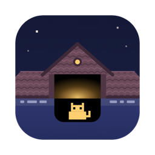
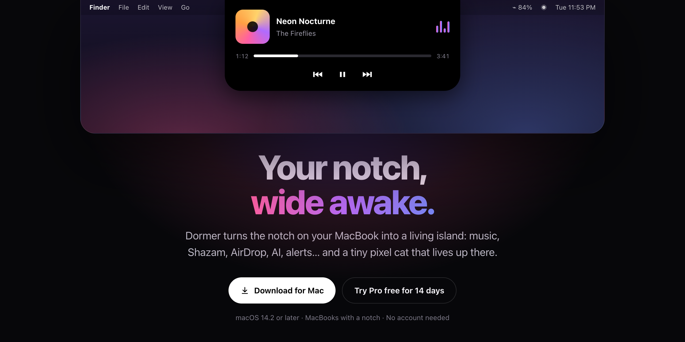
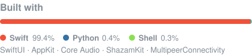

<p align="center">
  
</p>

<h1 align="center">Dormer</h1>

<p align="center">
  <b>Your notch, wide awake.</b><br>
  A Dynamic Island for your MacBook notch, with a pixel cat that lives in it.
</p>

<p align="center">
  <a href="https://github.com/Zerdoxy741/dormer/releases/latest"></a>
  <a href="https://zerdoxy741.github.io/dormer/"></a>
  
</p>

<p align="center">
  <a href="https://zerdoxy741.github.io/dormer/"></a>
</p>

<p align="center"><a href="#-en-français">🇫🇷 Lire en français</a></p>

---

## Only on Dormer

- 🐱 **A companion that lives in your notch.** A pixel cat (or dog, bunny, robot, ghost) that blinks, follows your cursor, dances to your music and falls asleep when you leave. Throw it a ball and it jumps out across your windows to catch it.
- 🎧 **Listen together.** Share what you're playing with Macs nearby. Friends see your song in their notch and listen in sync, with Spotify or Apple Music. Straight between Macs: no server, no account.

## Everything else

| | |
|---|---|
| 🎵 **Music player** | Artwork, controls, scrubbing, output device, synced lyrics |
| 🔎 **Shazam** | Ask the notch what song is playing |
| 📡 **Shelf & AirDrop** | Drop any file on the notch to keep it or AirDrop it |
| ✨ **ChatGPT & Claude** | See when an answer is being written, get pinged when it's ready |
| 🎚️ **MixVol** | Per-app volume, from the notch or the menu bar |
| 📋 **Clipboard history** | Your latest copies; images get a title written on-device |
| 🔔 **Alerts & calls** | AirPods and case battery, low battery, calls, upcoming events |
| 🎨 **Make it yours** | Notch style, size, colors, widgets, clock, HUDs |
| 🔄 **Built-in updates** | One click, settings kept |

## Free & Pro

Every download includes **14 days of Dormer Pro**, no account and no card. After that, the music player, shelf, AirDrop, calendar and weather stay free. **[Get Dormer Pro](https://buy.polar.sh/polar_cl_i0J4wAjf6ZKOnhGaEk4EFbYijV0jW689W7zpv001BK6)** to keep the companion, listen together, Shazam, AI, MixVol, clipboard, alerts and customization (one license per Mac).

## Install

1. **[Download the latest version](https://github.com/Zerdoxy741/dormer/releases/latest)** (`Dormer-….zip`), unzip it and drag **Dormer.app** into **Applications**.
2. Open Dormer. It isn't on the App Store, so macOS blocks it the first time: go to **System Settings › Privacy & Security** and click **Open Anyway**. If the button isn't there, run this in Terminal, then open Dormer again:
   ```bash
   xattr -dr com.apple.quarantine /Applications/Dormer.app
   ```
3. Accept permissions as they come (Accessibility, Calendar, Music, Bluetooth). Hover the notch, then click ⚙︎ for settings.

Requires a MacBook with a notch and **macOS 14.2 or later**. To quit: right-click the notch › Quit Dormer.

**Privacy:** clipboard history stays in memory on your Mac and is never sent anywhere.

<br>



---

## 🇫🇷 En français

**Ta notch, enfin réveillée.** Dormer transforme l'encoche de ton MacBook en île dynamique : musique, Shazam, AirDrop, presse-papiers, IA, alertes… et un petit chat en pixels qui vit dedans. *(Anciennement Notchy.)*

**Seulement sur Dormer**
- 🐱 **Un compagnon dans ta notch** : il cligne des yeux, suit ta souris, danse sur ta musique, s'endort quand tu pars, et sort sauter de fenêtre en fenêtre pour attraper sa balle.
- 🎧 **Écouter ensemble** : partage ta musique avec les Mac autour de toi, synchronisée, avec Spotify ou Musique. Sans serveur, sans compte.

**Et aussi** : lecteur de musique et paroles, Shazam, étagère et AirDrop, ChatGPT et Claude, MixVol (volume par app), presse-papiers, alertes (AirPods, batterie, appels, événements), personnalisation, mises à jour intégrées.

**Gratuit et Pro** : 14 jours de Dormer Pro offerts à chaque téléchargement. Ensuite, le lecteur, l'étagère, AirDrop, le calendrier et la météo restent gratuits. [Obtenir Dormer Pro](https://buy.polar.sh/polar_cl_i0J4wAjf6ZKOnhGaEk4EFbYijV0jW689W7zpv001BK6) (une licence par Mac).

**Installer**
1. [Télécharge la dernière version](https://github.com/Zerdoxy741/dormer/releases/latest), décompresse et glisse **Dormer.app** dans **Applications**.
2. Ouvre Dormer. macOS le bloque la première fois : **Réglages Système › Confidentialité et sécurité › Ouvrir quand même**. Sinon, colle ceci dans Terminal puis rouvre Dormer :
   ```bash
   xattr -dr com.apple.quarantine /Applications/Dormer.app
   ```
3. Accepte les autorisations au fur et à mesure. Survole la notch, puis l'icône ⚙︎ pour les réglages.

Tu as déjà Notchy ? Réglages › Mises à jour › « Rechercher les mises à jour » : l'app se met à jour et se renomme toute seule en Dormer, tes réglages sont gardés.

Il faut un MacBook avec une encoche et **macOS 14.2 ou plus récent**. Pour quitter : clic droit sur la notch › Quitter Dormer.
